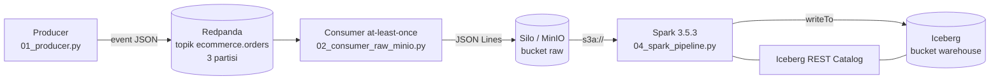
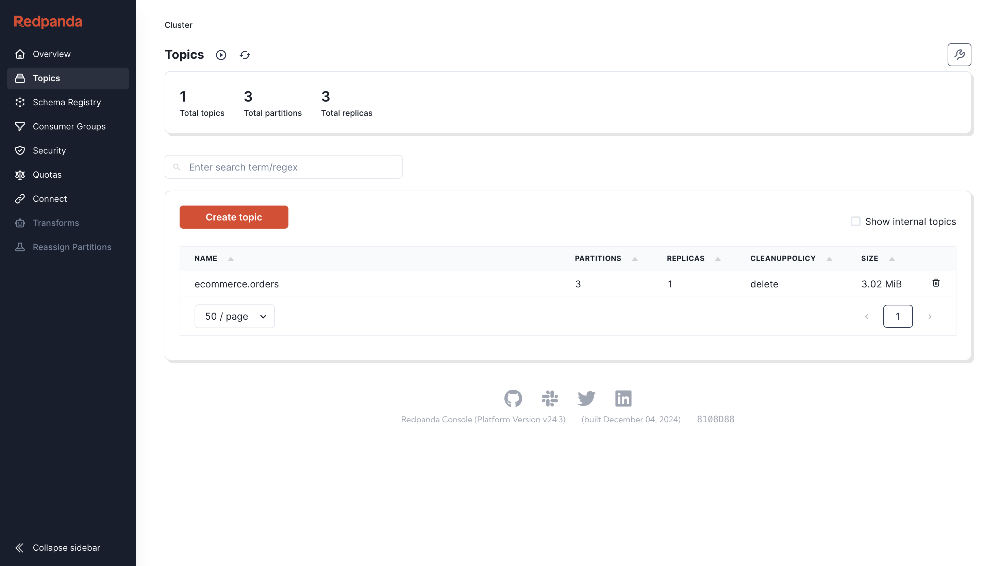
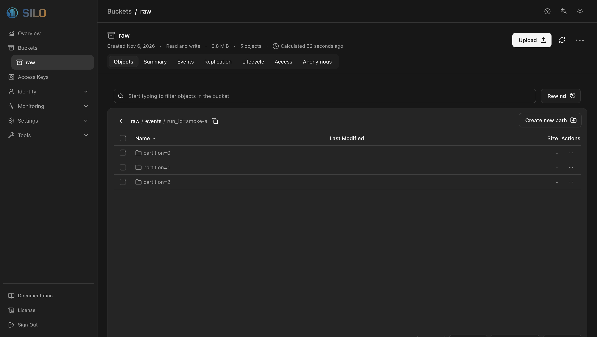
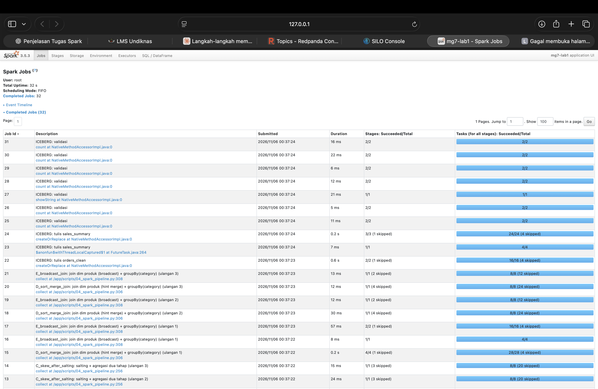
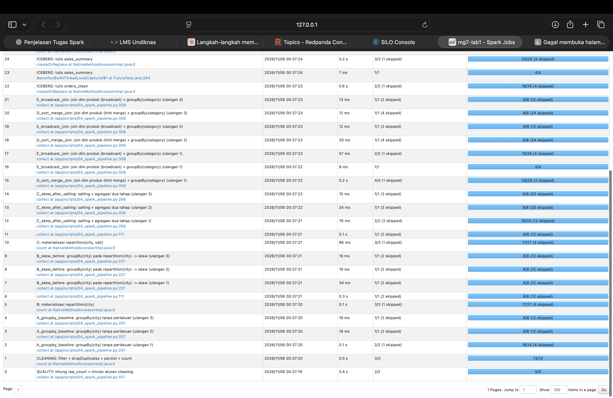
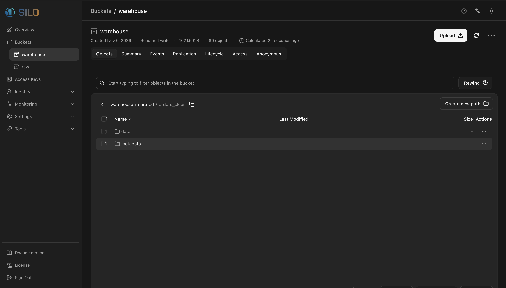

# Praktikum MG5–MG7: Pipeline Data End-to-End dengan Kafka, Spark, dan Iceberg

Repository ini berisi implementasi dan hasil **Milestone 2a** praktikum Analitik dan Skalabilitas Data: membangun alur data dari *event stream* hingga tabel analitik, lalu menganalisis dan mengoptimasi eksekusi Apache Spark.

> **Alur data:** Producer → Redpanda (Kafka) → Consumer → Silo/MinIO (`raw`) → Spark (cleaning + analisis) → Apache Iceberg (`warehouse`)

**Disusun oleh:** *(I Made Obi Pranata (42430003))* · **GitHub:** [obipranata2006](https://github.com/obipranata2006)

---

## Daftar Isi

1. [Tujuan](#1-tujuan)
2. [Arsitektur](#2-arsitektur)
3. [Struktur Repository](#3-struktur-repository)
4. [Teknologi dan Versi](#4-teknologi-dan-versi)
5. [Cara Menjalankan](#5-cara-menjalankan)
6. [Penjelasan Tiap Tahap](#6-penjelasan-tiap-tahap)
7. [Hasil Eksperimen (run `lab1`, 20.000 baris)](#7-hasil-eksperimen-run-lab1-20000-baris)
8. [Bukti Screenshot](#8-bukti-screenshot)
9. [Analisis untuk Laporan](#9-analisis-untuk-laporan)
10. [Keterbatasan dan Catatan Kejujuran](#10-keterbatasan-dan-catatan-kejujuran)
11. [Troubleshooting](#11-troubleshooting)

---

## 1. Tujuan

1. Membangun pipeline *ingestion* berbasis Kafka (Redpanda) dengan consumer **at-least-once** yang menyimpan data mentah ke object storage.
2. Membersihkan data dengan Spark dan memvalidasi kualitasnya (aturan cleaning, penghitungan baris ditolak, penghapusan duplikat).
3. Membaca **DAG, stage, dan shuffle** melalui Spark Web UI dan *physical plan*.
4. Menunjukkan dan mengatasi **data skew** dengan *key salting* dan agregasi dua tahap.
5. Membandingkan **SortMergeJoin** dengan **BroadcastHashJoin**.
6. Menulis tabel *curated* ke **Apache Iceberg** dan membuktikan **partition pruning**.

---

## 2. Arsitektur



| Komponen | Peran | Alamat dari komputer host |
|---|---|---|
| Redpanda | Broker Kafka | `localhost:19092` |
| Redpanda Console | GUI untuk topik dan pesan | http://localhost:8088 |
| Silo (fork MinIO) | Object storage S3-compatible | http://localhost:9000 (API), http://localhost:9001 (Console) |
| Iceberg REST Catalog | Menyimpan metadata tabel | http://localhost:8181 |
| Spark | Pemrosesan data | http://localhost:4040 (hanya saat job berjalan) |

---

## 3. Struktur Repository

```text
.
├── docker-compose.yml          # Definisi seluruh layanan
├── docker/
│   ├── Dockerfile.tools        # Python: producer, consumer, inspeksi, audit
│   └── Dockerfile.spark        # Spark 3.5.3 + Java 17 + Python 3
├── scripts/
│   ├── 00_setup.py             # Membuat bucket raw dan warehouse
│   ├── 01_producer.py          # Producer event sintetik
│   ├── 02_consumer_raw_minio.py# Consumer: Kafka -> JSONL -> bucket raw
│   ├── 03_inspect_raw.py       # Validasi data raw
│   ├── 04_spark_pipeline.py    # Cleaning, DAG/skew/join, Iceberg
│   ├── 05_audit_hasil.py       # Audit otomatis artefak hasil
│   └── run_spark.sh            # spark-submit + konfigurasi S3A dan Iceberg
├── hasil/<run-id>/             # Artefak tiap eksperimen (lihat bagian 7)
├── screenshots/                # Bukti visual (lihat bagian 8)
├── laporan/TEMPLATE_LAPORAN.md # Kerangka laporan
└── spark.log                   # Log eksekusi Spark run lab1
```

---

## 4. Teknologi dan Versi

| Komponen | Versi / Image |
|---|---|
| Redpanda | `docker.redpanda.com/redpandadata/redpanda:v26.2.5` |
| Redpanda Console | `v2.8.0` |
| Object storage | `docker.io/pgsty/silo:latest` (fork MinIO, lihat bagian 10) |
| Iceberg REST Catalog | `tabulario/iceberg-rest:1.6.0` |
| Apache Spark | 3.5.3 (Scala 2.12, Java 17), mode `local[4]`, driver 3 GB |
| Apache Iceberg | `iceberg-spark-runtime-3.5_2.12:1.7.1` |
| Konektor S3 | `hadoop-aws:3.3.4`, `aws-java-sdk-bundle:1.12.262`, `iceberg-aws-bundle:1.7.1` |
| Python (tools) | 3.11, `kafka-python==2.0.2`, `boto3` |
| Lingkungan | Docker Desktop di Mac (arsitektur aarch64) |

Konfigurasi Spark yang sengaja diatur: **AQE dimatikan** (`spark.sql.adaptive.enabled=false`) dan **auto-broadcast dimatikan** (`spark.sql.autoBroadcastJoinThreshold=-1`), supaya strategi eksekusi yang dipilih secara manual terlihat jelas di *physical plan*.

---

## 5. Cara Menjalankan

Prasyarat: Docker Desktop, RAM minimal 8 GB (alokasikan 6–8 GB ke Docker), dan disk kosong sekitar 10 GB.

```bash
# 1. Jalankan semua layanan (build pertama membutuhkan beberapa menit)
docker compose up -d --build
docker compose ps                      # tunggu 10-30 detik sampai semua Up

# 2. Buat bucket dan topik
docker compose exec tools python scripts/00_setup.py
docker compose exec redpanda rpk topic create ecommerce.orders -p 3 -r 1

# 3. Ingestion: producer -> Kafka -> consumer -> bucket raw
docker compose exec tools python scripts/01_producer.py --rows 20000 --run-id lab1
docker compose exec tools python scripts/02_consumer_raw_minio.py --expected 20000 --run-id lab1
docker compose exec tools python scripts/03_inspect_raw.py --run-id lab1

# 4. Spark: cleaning, eksperimen, tulis Iceberg.
#    --hold 900 menahan Spark UI tetap hidup 15 menit untuk screenshot.
docker compose exec spark bash scripts/run_spark.sh \
  --run-id lab1 --shuffle-partitions 8 --salt-buckets 16 --hold 900

# 5. Audit otomatis artefak hasil
docker compose exec tools python scripts/05_audit_hasil.py --run-id lab1
```

Eksperimen skala besar (1 juta baris) memakai langkah yang sama dengan `--rows 1000000 --expected 1000000 --run-id kelas-1m`. Satu eksperimen memakai satu `--run-id` yang konsisten di producer, consumer, dan Spark.

Kredensial di repository ini (`labadmin` / `labpassword123`) adalah **dummy** untuk lab lokal.

---

## 6. Penjelasan Tiap Tahap

### 6.1 Ingestion: Producer dan Kafka (MG5)

`01_producer.py` membuat event transaksi sintetik yang *reproducible* (seed tetap) dengan format:

```json
{"run_id": "lab1", "order_id": 1, "event_time": "2026-09-01T10:00:48",
 "city": "DENPASAR", "product_id": 63, "quantity": 2, "amount": 81}
```

Karakteristik data yang sengaja dibuat:

- **Hot key**: sekitar 80% transaksi berasal dari Denpasar, 10% Jakarta, 10% Surabaya. Ini yang nanti menimbulkan *data skew*.
- **Data kotor**: `order_id` kelipatan 500 (kecuali kelipatan 200.000) dibuat tidak valid, separuhnya `city` kosong dan separuhnya `amount` null. Pada 20.000 event ada 40 baris tidak valid.
- **Noise penulisan**: nama kota ditulis `DENPASAR`, `  denpasar ` (berspasi), atau `Denpasar`, untuk menguji standardisasi.

Kunci pesan Kafka adalah `product_id`, sehingga pesan tersebar ke 3 partisi. Producer memakai `acks="all"` dan `retries=5`, lalu `flush()` untuk memastikan semua pesan terkirim sebelum mencetak `PRODUCER_OK`.

### 6.2 Consumer at-least-once ke Object Storage

`02_consumer_raw_minio.py` membaca pesan per partisi, menyimpannya sebagai file **JSON Lines** di `raw/events/run_id=<id>/partition=<n>/offset-<awal>-<akhir>.jsonl`, dan **baru melakukan commit offset setelah upload berhasil**.

Urutan ini menjamin *at-least-once*: jika proses mati setelah upload tapi sebelum commit, batch yang sama terbaca ulang (data **terduplikasi, tidak hilang**). Duplikat itu dibuang di tahap Spark lewat `dropDuplicates(["run_id", "order_id"])`. Kalau urutannya dibalik (commit dulu, upload kemudian), kegagalan upload akan menyebabkan data **hilang permanen**.

Nama file memuat rentang offset, sehingga setiap batch tercatat jelas dan bisa ditelusuri.

### 6.3 Cleaning dan Data Quality (MG6)

`04_spark_pipeline.py` membaca JSONL dengan **schema eksplisit** (bukan *schema inference*, agar tipe data stabil dan tidak ada pembacaan ganda), lalu menerapkan aturan:

| Aturan | Tujuan |
|---|---|
| `city = initcap(trim(city))` | Standardisasi penulisan kota |
| Buang `city` kosong atau null | Wajib ada kota |
| Buang `amount` null atau negatif | Nilai transaksi harus valid |
| Buang `quantity <= 0` | Jumlah barang harus positif |
| `dropDuplicates(run_id, order_id)` | Idempoten terhadap pengiriman ulang (at-least-once) |
| Kolom turunan `sale_date` dari `event_time` | Dasar partisi tabel Iceberg |

Hasil cleaning di-`persist` (`MEMORY_AND_DISK`) lalu di-`count`, sehingga percobaan berikutnya membaca dari cache dan perbandingannya adil. Ringkasan kualitas tersimpan di `quality.json`.

### 6.4 DAG, Stage, dan Shuffle (Percobaan A)

Spark bersifat *lazy*: **transformation** (`filter`, `select`, `groupBy.agg`) hanya membangun rencana, dan baru **action** (`count`, `collect`, `writeTo`) yang memicu eksekusi. Satu action menjadi satu **job**, job dipecah menjadi **stage** pada batas shuffle, dan stage dipecah menjadi **task** (satu per partisi).

- **Narrow transformation** (`filter`, `select`, `withColumn`): tiap partisi diproses sendiri, tanpa pindah data antarpartisi.
- **Wide transformation** (`groupBy`, `join`, `repartition`): data harus dikelompokkan ulang lintas partisi, ditandai operator **Exchange** pada plan. Di sinilah biaya jaringan, serialisasi, dan *spill* muncul.

Plan percobaan A memperlihatkan pola `HashAggregate (partial) → Exchange hashpartitioning(city, 8) → HashAggregate (final)`: agregasi parsial dilakukan lokal di tiap partisi, lalu hasil antara di-shuffle berdasarkan `city`, lalu digabung.

### 6.5 Data Skew dan Key Salting (Percobaan B dan C)

**Masalah (B).** Data dipartisi dengan `repartition(8, "city")`. Karena Denpasar menguasai sekitar 80% data, seluruh barisnya masuk ke **satu partisi**, sehingga satu task bekerja jauh lebih berat daripada yang lain dan menjadi *straggler* yang menentukan waktu stage.

**Solusi (C): key salting + agregasi dua tahap.**

```python
salted = (cleaned
  .withColumn("salt", F.pmod(F.xxhash64("order_id"), F.lit(16)))
  .repartition(8, "city", "salt"))

partial = salted.groupBy("city", "salt").agg(F.count("*").alias("orders_partial"),
                                              F.sum("amount").alias("sales_partial"))
final = partial.groupBy("city").agg(F.sum("orders_partial").alias("orders"),
                                    F.sum("sales_partial").alias("gross_sales"))
```

Kunci panas dipecah menjadi `(Denpasar, 0) … (Denpasar, 15)` sehingga tersebar ke banyak partisi, dihitung parsial, lalu dijumlahkan kembali. Hasil akhir harus **identik** dengan baseline, dan ini diperiksa dengan *assertion* (`VALIDASI_SALTING_OK`). Harga yang dibayar: ada satu `groupBy` tambahan dan satu shuffle tambahan.

### 6.6 SortMergeJoin vs BroadcastHashJoin (Percobaan D dan E)

Tabel transaksi (besar) di-*join* dengan dimensi produk kecil (200 baris, 4 kategori):

- **D, SortMergeJoin** (`dim.hint("merge")`): kedua sisi di-shuffle berdasarkan `product_id`, diurutkan, lalu digabung. Cocok untuk dua tabel besar.
- **E, BroadcastHashJoin** (`F.broadcast(dim)`): tabel kecil disalin ke setiap executor, sehingga **sisi besar tidak perlu di-shuffle** untuk join.

Hasil kedua join harus sama dan jumlah transaksi seluruh kategori harus sama dengan `CLEAN_COUNT` (`VALIDASI_JOIN_OK`). Perlu dicatat bahwa `groupBy(category)` setelah join **tetap memicu shuffle**, karena broadcast hanya mengoptimasi tahap join.

### 6.7 Apache Iceberg dan Partition Pruning

Dua tabel *curated* ditulis ke katalog `lake.curated`, dipartisi per `sale_date`:

- `orders_clean`: detail transaksi bersih.
- `sales_summary`: agregasi tanggal × kota × kategori (jumlah order, unit, penjualan kotor, rata-rata nilai order).

Iceberg menyimpan data (Parquet) dan metadata (snapshot, manifest) di bucket `warehouse`, sedangkan katalog REST menyimpan penunjuk ke metadata terbaru. Setiap penulisan membuat **snapshot** baru, sehingga riwayat tabel bisa ditelusuri. Pada query dengan filter `sale_date`, Iceberg hanya membaca file data pada partisi yang relevan (**partition pruning**).

---

## 7. Hasil Eksperimen (run `lab1`, 20.000 baris)

Semua angka di bagian ini berasal dari log eksekusi (`spark.log`) dan artefak di `hasil/lab1/`.

### 7.1 Ingestion

| Item | Hasil |
|---|---|
| Event terkirim (producer) | 20.000 |
| Pesan diterima consumer | 20.000, tersimpan sebagai 8 objek JSONL (partisi 0: 2, partisi 1: 4, partisi 2: 2) |
| Ukuran total raw | 2.872.273 byte |

### 7.2 Data quality

| Metrik | Nilai |
|---|---|
| `RAW_COUNT` | 20.000 |
| `CLEAN_COUNT` | 19.960 |
| `REJECTED_COUNT` | 40 |

Selisih 40 baris sesuai desain generator: 20 baris `city` kosong dan 20 baris `amount` null (rincian pasti tercatat di `quality.json`).

### 7.3 Agregasi per kota (percobaan A, B, C menghasilkan angka identik)

| Kota | Jumlah order | Penjualan kotor |
|---|---:|---:|
| Denpasar | 15.937 | 4.080.633 |
| Jakarta | 2.023 | 515.998 |
| Surabaya | 2.000 | 510.685 |
| **Total** | **19.960** | |

### 7.4 Data skew: sebelum dan sesudah salting

| Metrik | Sebelum (`repartition(city)`) | Sesudah (`city` + `salt`) |
|---|---|---|
| Jumlah partisi | 8 | 8 |
| Partisi berisi data | **3** dari 8 | **8** dari 8 |
| Partisi terbesar | 15.937 baris | 5.574 baris |
| Partisi terkecil | 0 baris | 254 baris |
| Skew ratio (terbesar ÷ rata-rata) | **6,39** | **2,23** |

Distribusi baris per partisi:

- **Sebelum:** `[0, 0, 2023, 15937, 0, 0, 2000, 0]`
- **Sesudah:** `[2491, 1875, 5574, 4475, 254, 1229, 1428, 2634]`

### 7.5 Benchmark (3 ulangan per percobaan)

| Percobaan | Ulangan 1 (s) | Ulangan 2 (s) | Ulangan 3 (s) | **Median (s)** |
|---|---:|---:|---:|---:|
| A: groupBy baseline | 0,197 | 0,045 | 0,047 | **0,0474** |
| B: skew sebelum | 0,059 | 0,035 | 0,038 | **0,0381** |
| C: setelah salting | 0,104 | 0,023 | 0,025 | **0,0254** |
| D: SortMergeJoin | 0,215 | 0,025 | 0,021 | **0,0253** |
| E: BroadcastHashJoin | 0,097 | 0,034 | 0,023 | **0,0345** |

Perbandingan (rumus: perubahan = (baseline − optimasi) ÷ baseline × 100%; speedup = baseline ÷ optimasi):

| Perbandingan | Perubahan | Speedup |
|---|---:|---:|
| Salting: B → C | +33,3% | 1,50× |
| Join: D → E | −36,4% | 0,73× |

> **Catatan penting:** semua waktu hanya hitungan **milidetik** pada data 20.000 baris. Ulangan pertama selalu 3–10 kali lebih lambat daripada ulangan berikutnya (efek pemanasan JVM dan kompilasi kode), dan selisih antarpercobaan jauh lebih kecil daripada variasi tersebut. Karena itu **angka waktu pada run ini tidak boleh dijadikan dasar kesimpulan**. Bukti yang kuat ada pada keseimbangan partisi (7.4) dan bentuk physical plan (7.6). Untuk perbandingan waktu yang bermakna, dipakai run skala besar `kelas-1m`.

### 7.6 Operator pada physical plan

| Plan | Operator kunci | Keterangan |
|---|---|---|
| A (`plan_A_groupby_baseline.txt`) | `HashAggregate → Exchange hashpartitioning(city, 8) → HashAggregate` | Shuffle akibat `groupBy` |
| B (`plan_B_skew_before.txt`) | Dua `HashAggregate` **tanpa** Exchange di antaranya | Data sudah dipartisi per `city`; Exchange pindah ke tahap materialisasi cache |
| C (`plan_C_skew_after_salting.txt`) | Agregasi `(city, salt)` → agregasi `city` dengan `Exchange` di tengah | Agregasi dua tahap |
| D (`plan_D_sort_merge_join.txt`) | `SortMergeJoin`, `Sort`, `Exchange` di kedua sisi | Dua sisi di-shuffle dan diurutkan |
| E (`plan_E_broadcast_join.txt`) | `BroadcastHashJoin`, `BroadcastExchange` | Sisi besar tidak di-shuffle untuk join |

### 7.7 Join dengan dimensi produk (D dan E menghasilkan angka identik)

| Kategori | Jumlah order | Penjualan kotor |
|---|---:|---:|
| Elektronik | 5.097 | 1.306.590 |
| Makanan | 5.094 | 1.301.918 |
| Fashion | 4.868 | 1.251.527 |
| Rumah Tangga | 4.901 | 1.247.281 |
| **Total** | **19.960** | |

### 7.8 Iceberg dan partition pruning

| Item | Hasil |
|---|---|
| Baris `orders_clean` | 19.960 (sama dengan `CLEAN_COUNT`) |
| Baris `sales_summary` | 84 (7 tanggal × 3 kota × 4 kategori) |
| Jumlah snapshot | 3 (tabel ditulis ulang pada tiap run Spark; `createOrReplace`) |
| Filter `sale_date = 2026-09-05` | 2.775 baris, **1 dari 7** file data dibaca |
| Predicate di plan | `filters=sale_date IS NOT NULL, sale_date = 20701` pada `BatchScan lake.curated.orders_clean` |

### 7.9 Eksperimen skala besar

Run `kelas-1m` (1.000.000 event, bersih diharapkan 998.005 baris) tersimpan di `hasil/kelas-1m/`, dengan berkas yang sama seperti `lab1`: `quality.json`, `benchmarks.csv`, `partition_sizes.csv`, dan `plan_*.txt`.

---

## 8. Bukti Screenshot

Lima tangkapan layar dari eksekusi nyata pipeline: satu dari Redpanda Console, dua dari Silo Console, dan dua dari Spark Web UI (aplikasi `mg7-lab1`).

### Gambar 1. Redpanda Console: topik `ecommerce.orders`


Halaman **Topics** menampilkan satu topik, `ecommerce.orders`, dengan **3 partisi**, **1 replika** per partisi, kebijakan pembersihan `delete`, dan ukuran **3,02 MiB**. Ringkasan di bagian atas menunjukkan 1 topik, 3 partisi, dan 3 replika secara total. Gambar ini membuktikan bahwa topik dibuat sesuai perintah `rpk topic create ecommerce.orders -p 3 -r 1` dan sudah berisi data hasil producer. Ukuran 3,02 MiB mencakup pesan dari beberapa run (`smoke-a`, `lab1`, dan seterusnya) karena topik yang sama dipakai bersama.

### Gambar 2. Silo Console: bucket `raw` (data mentah dari consumer)


Bucket `raw` menyimpan data pada jalur `raw/events/run_id=smoke-a/` dengan tiga folder, `partition=0`, `partition=1`, dan `partition=2`, sesuai tiga partisi topik Kafka. Ini membuktikan consumer menulis tiap batch ke object storage per partisi sumbernya, sehingga jejak asal data (partisi dan rentang offset) tetap terbaca dari nama jalur dan nama file. Catatan: tangkapan layar ini diambil pada run **`smoke-a`**; run `lab1` memakai struktur jalur yang sama (`run_id=lab1`), dan angka hasil `lab1` ada di bagian 7. Angka "5 objects" di kepala halaman dihitung berkala oleh Console (tertulis *Calculated 52 seconds ago*), sehingga bisa tertinggal dari isi sebenarnya.

### Gambar 3. Spark Web UI, tab Jobs (bagian atas)


Halaman **Jobs** aplikasi `mg7-lab1` (Spark 3.5.3, pengguna `root`, mode penjadwalan FIFO) mencatat **32 job selesai** dalam **total uptime 32 detik**. Bagian atas daftar menampilkan job terakhir: tujuh job validasi Iceberg (job 25 sampai 31, masing-masing 5 sampai 22 milidetik), penulisan tabel `sales_summary` (job 23 dan 24) dan `orders_clean` (job 22, 0,6 detik), serta percobaan join E (`BroadcastHashJoin`) dan D (`SortMergeJoin`) pada ulangan 1 sampai 3. Setiap job memakai **label deskriptif** hasil `setJobDescription`, sehingga mudah dipetakan ke percobaan di kode.

### Gambar 4. Spark Web UI, tab Jobs (daftar lengkap, job 0 sampai 24)


Bagian bawah daftar job melengkapi urutan eksekusi dari awal:

| Job | Label | Durasi | Stage | Task |
|---:|---|---:|---|---|
| 0 | QUALITY: hitung raw_count dan rincian aturan cleaning | 0,4 s | 2/2 | 5/5 |
| 1 | CLEANING: filter, dropDuplicates, persist, count | 0,5 s | 3/3 | 13/13 |
| 2–4 | A: groupBy(city) tanpa perlakuan (ulangan 1–3) | 0,1 s, 19 ms, 18 ms | 2/2, lalu 1/1 | 16/16, lalu 8/8 |
| 5 | B: materialisasi `repartition(city)` | 0,1 s | 3/3 | 17/17 |
| 6 | Penghitungan ukuran partisi sebelum salting (`collect` pada baris 111) | 0,3 s | 1/1 | 8/8 |
| 7–9 | B: groupBy(city) pada data skew (ulangan 1–3) | 34, 19, 18 ms | 1/1 | 8/8 |
| 10 | C: materialisasi `repartition(city, salt)` | 86 ms | 3/3 | 17/17 |
| 11 | Penghitungan ukuran partisi sesudah salting | 0,1 s | 1/1 | 8/8 |
| 12–14 | C: salting + agregasi dua tahap (ulangan 1–3) | 76, 24, 15 ms | 2/2, lalu 1/1 | 16/16, lalu 8/8 |
| 15–21 | D dan E: SortMergeJoin dan BroadcastHashJoin (ulangan 1–3) | 8 ms sampai 0,2 s | 1/1 sampai 4/4 | bervariasi |
| 22 | ICEBERG: tulis `orders_clean` | 0,6 s | 2/2 | 16/16 |
| 23–24 | ICEBERG: tulis `sales_summary` | 7 ms, 0,2 s | 1/1, 3/3 | 4/4, 24/24 |

Hal yang bisa dibaca dari gambar ini:

- **Stage "skipped"** (misalnya `1/1 (2 skipped)` pada ulangan 2 dan 3) berarti Spark memakai ulang hasil antara yang sudah ada (data cache dan keluaran shuffle) dan tidak menghitung ulang tahap awal. Itu sebabnya ulangan pertama selalu paling lambat dan ulangan berikutnya hanya hitungan milidetik.
- Pembacaan dan pembersihan data mentah (job 0 dan 1, total sekitar 0,9 detik) serta penulisan tabel Iceberg (job 22 dan 24, sekitar 0,8 detik) adalah pekerjaan terberat; percobaan agregasi dan join pada data yang sudah di-cache jauh lebih ringan.
- Skala durasi, 8 ms sampai 0,2 s per job, konsisten dengan temuan di bagian 7.5: pada data 20.000 baris, selisih waktu antarpercobaan terlalu kecil untuk dijadikan dasar kesimpulan performa.

### Gambar 5. Silo Console: bucket `warehouse` (tabel Iceberg)


Bucket `warehouse` berisi **80 objek** (total **1021,5 KiB**). Jalur `warehouse/curated/orders_clean` memperlihatkan dua folder khas Iceberg: **`data`** (file Parquet hasil penulisan, dipartisi per `sale_date`) dan **`metadata`** (file metadata tabel, daftar manifest, dan snapshot). Gambar ini membuktikan tabel `orders_clean` benar-benar tersimpan sebagai tabel Iceberg di object storage, dengan pemisahan antara data dan metadata. Metadata inilah yang memungkinkan riwayat snapshot (3 snapshot pada bagian 7.8) dan *partition pruning*.

---

## 9. Analisis untuk Laporan

Bagian ini memuat kerangka penjelasan yang bisa dikembangkan menjadi laporan.

### 9.1 Mengapa offset di-commit setelah upload?

Commit offset adalah janji bahwa pesan sampai offset itu sudah diproses. Jika commit dilakukan **sebelum** upload dan upload gagal, pesan tersebut dianggap selesai padahal tidak tersimpan, sehingga **data hilang**. Jika commit dilakukan **sesudah** upload dan proses mati di antara keduanya, pesan terbaca ulang, sehingga **data terduplikasi**. Duplikasi bisa dibersihkan (dengan kunci `run_id` + `order_id`), kehilangan data tidak bisa dipulihkan. Itulah alasan semantik *at-least-once* dipilih, dilengkapi deduplikasi di hilir agar hasil akhirnya tetap benar.

### 9.2 Hubungan raw_count, clean_count, dan aturan cleaning

`RAW_COUNT − CLEAN_COUNT = REJECTED_COUNT`. Pada `lab1`, 40 baris ditolak karena `city` kosong atau `amount` null, sesuai pola data kotor di generator. Duplikat tidak muncul karena consumer tidak mengalami pengiriman ulang pada run ini, namun aturan `dropDuplicates` tetap dipertahankan sebagai pengaman.

### 9.3 Narrow vs wide transformation

`filter(city == "Denpasar")` bersifat narrow: setiap partisi diproses mandiri, tanpa Exchange. `groupBy("city")` bersifat wide: nilai `city` yang sama tersebar di banyak partisi, sehingga harus dikumpulkan dengan shuffle (Exchange) dan memunculkan stage baru. Shuffle mahal karena melibatkan serialisasi, penulisan ke disk, dan transfer data.

### 9.4 Mengapa terjadi skew dan apa yang diperbaiki salting?

Partisi ditentukan oleh hash dari kunci. Karena sekitar 80% baris memiliki kunci yang sama (Denpasar), semuanya mendarat di satu partisi: hanya 3 dari 8 partisi berisi data, dan satu partisi memuat 15.937 baris (skew ratio 6,39). Waktu stage ditentukan oleh task terlama, sehingga paralelisme yang tersedia tidak terpakai.

Salting menambahkan komponen acak-deterministik (`salt`) ke kunci, sehingga baris Denpasar tersebar ke banyak partisi. Hasilnya, seluruh 8 partisi terisi dan skew ratio turun ke 2,23. Skew ratio tidak turun mendekati 1 karena hanya ada 3 kota × 16 salt = 48 kunci gabungan yang di-hash ke 8 partisi, sehingga masih ada tabrakan hash (partisi terbesar 5.574 baris, terkecil 254).

### 9.5 Apakah salting selalu mempercepat?

Tidak. Salting memperbaiki keseimbangan beban, tetapi menambah satu tahap agregasi dan satu shuffle. Pada data kecil dan mode `local[4]`, overhead itu bisa setara atau lebih besar daripada keuntungannya. Pada `lab1`, selisih waktu hanya hitungan milidetik dan ikut dipengaruhi pemanasan JVM, sehingga yang dijadikan bukti utama adalah distribusi partisi, bukan waktu. Keuntungan waktu baru terlihat jelas pada data besar dan cluster dengan banyak executor.

### 9.6 Kapan memilih broadcast join, dan kapan tidak?

Broadcast join layak bila salah satu tabel cukup kecil untuk muat di memori setiap executor (di sini dimensi 200 baris). Keuntungannya: sisi besar tidak perlu di-shuffle untuk join. Risikonya: jika tabel yang di-broadcast ternyata besar (misalnya beberapa GB), memori driver dan executor bisa habis (*OutOfMemoryError*), dan penyalinan ke semua executor justru mahal. Untuk dua tabel besar, SortMergeJoin lebih aman. Pada `lab1`, broadcast tampak lebih lambat, tetapi selisihnya berada dalam rentang *noise* sehingga tidak bisa dijadikan kesimpulan.

### 9.7 Peran Iceberg

Iceberg menambahkan lapisan tabel di atas file Parquet: snapshot (riwayat versi tabel), manifest (daftar file dan statistik), dan partisi tersembunyi. Dengan filter `sale_date = 2026-09-05`, Spark hanya membaca 1 dari 7 file data, dan hal ini terbukti pada plan (`sale_date = 20701` pada `BatchScan`). Jumlah snapshot bertambah pada setiap penulisan, sehingga bisa dipakai untuk audit dan *time travel*.

### 9.8 Mengapa AQE dan auto-broadcast dimatikan?

*Adaptive Query Execution* dan auto-broadcast bisa mengubah rencana eksekusi secara otomatis (misalnya mengganti SortMergeJoin menjadi BroadcastHashJoin atau menggabungkan partisi kecil). Untuk tujuan belajar, dua fitur itu dimatikan agar perbedaan akibat pilihan manual (salting, hint join) terlihat jelas dan dapat dibandingkan secara terkendali. Pada produksi, keduanya biasanya dibiarkan aktif.

### 9.9 Cara membaca Spark Web UI

| Tab | Yang diamati |
|---|---|
| **Jobs** | Daftar job (setiap action = satu job) beserta durasi dan jumlah stage |
| **Stages** | Jumlah task, durasi task terpanjang, *Shuffle Read/Write*, dan *Spill*: tempat skew terlihat |
| **SQL** | Diagram operator; bandingkan dengan file `plan_*.txt` |
| **Executors** | Penggunaan memori, I/O, dan jumlah task per executor |

---

## 10. Keterbatasan dan Catatan Kejujuran

- **Paket kode dibuat ulang.** Skrip dan konfigurasi dalam repository ini ditulis ulang untuk praktikum ini (bukan paket asli yang disediakan dosen). Nama berkas, nama topik dan bucket, serta pesan log (`PRODUCER_OK`, `VALIDASI_SALTING_OK`, dst.) mengikuti modul. Angka pasti pada data sintetik (misalnya 19.960 dan 998.005 baris bersih) berasal dari generator yang dibuat ulang tersebut.
- **Silo menggantikan MinIO.** Image Docker resmi MinIO sudah dicabut dari Docker Hub, sehingga digunakan **Silo** (fork MinIO) sebagai object storage S3-compatible. Fungsi untuk praktikum sama: bucket `raw` dan `warehouse`, akses S3A dari Spark, dan penyimpanan file Iceberg.
- **Spark `local[4]`**, bukan cluster multi-worker. Hasil benchmark pada mode ini tidak otomatis berlaku pada cluster sungguhan.
- **Data kecil pada run `lab1`.** Waktu eksekusi hanya milidetik dan didominasi pemanasan JVM; kesimpulan performa tidak diambil dari run ini.
- **Snapshot Iceberg bertambah** karena tabel ditulis ulang (`createOrReplace`) pada setiap run, termasuk run percobaan sebelumnya.
- Kredensial dummy hanya untuk lab lokal.

---

## 11. Troubleshooting

| Gejala | Penyebab dan solusi |
|---|---|
| `docker compose up` gagal menarik image | Periksa koneksi internet; ganti tag image yang tidak tersedia di `docker-compose.yml` |
| Port sudah dipakai | Matikan aplikasi yang memakai port 8088, 9000, 9001, 4040, atau 8181 |
| `NoBrokersAvailable` | Tunggu Redpanda siap: `docker compose logs --tail=80 redpanda` |
| Consumer timeout | `--run-id` dan `--expected` harus sama dengan producer; untuk run-id yang sudah selesai, pakai `--group-id` baru |
| `localhost:4040` tidak bisa dibuka | Spark UI hanya hidup saat job berjalan; jalankan dengan `--hold 900` dan buka `http://127.0.0.1:4040` |
| `OutOfMemoryError` | Naikkan RAM Docker (Settings → Resources) atau kurangi `--rows` |
| `ClassNotFoundException` / S3A error | Pastikan ada internet saat `spark-submit` pertama (mengunduh JAR Maven) |
